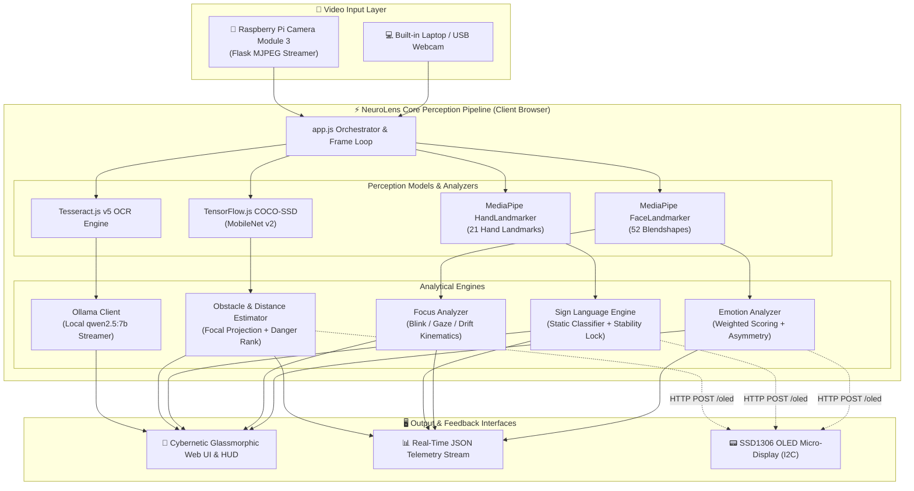

# 🧠 NeuroLens

<p align="center">
  <strong>Real-time Edge & Browser Multimodal AI Perception System for Accessibility, Emotion, Attention, and Spatial Awareness</strong>
</p>

<p align="center">
  
  
  
  
  
  
  
</p>

---

## 📌 Overview

**NeuroLens** is an intelligent, privacy-first computer vision and multimodal edge AI platform designed for accessibility, cognitive monitoring, and assistive spatial awareness. It processes multi-sensory visual signals in real time directly within the browser or on resource-constrained embedded edge devices (Raspberry Pi Zero 2W / Pi 4/5) without sending raw video feeds to external cloud services.

Whether assisting individuals with speech and hearing impairments, assessing student or operator focus levels, navigating surroundings with assistive collision warning HUDs, or scanning printed text with on-device generative AI summarization, NeuroLens delivers a unified perception pipeline with zero cloud latency.

---

## ✨ Key Features

| Feature | Input Stream | Engine & Model Architecture | Key Highlights |
|---|---|---|---|
| 😄 **Emotion Recognition** | Webcam / Pi Stream (Face) | MediaPipe FaceLandmarker + 52 Blendshapes | 7 core emotions + contempt detection, asymmetric smile detection, EMA smoothing |
| 🎯 **Focus & Attention Tracking** | Webcam / Pi Stream (Face) | MediaPipe FaceLandmarker + Gaze & Head Kinematics | 4-signal heuristic (blink rate, gaze variance, head drift, eye openness), majority-vote state smoothing |
| 🤟 **Sign Language (ASL) Recognition** | Webcam / Pi Stream (Hands) | MediaPipe HandLandmarker + Kinematic Rule Engine | 30-word vocabulary, 30+ geometric features, 4-tier anti-duplication engine (stability, locking, cooldown) |
| 🚧 **Spatial Obstacle Detection** | Webcam / Pi Stream (Scene) | TensorFlow.js COCO-SSD (MobileNet v2) / YOLOv4-tiny | Focal-length distance estimation, 3 risk zones (Safe, Near, Very Close), cybernetic canvas HUD overlay |
| 📝 **Smart OCR & Text Summarizer** | Frozen Frame (Webcam / Pi) | Tesseract.js v5 + Local Ollama LLM (`qwen2.5:7b`) | On-device text extraction, bounding-box highlighting, streaming AI summarization |
| 🍓 **Edge Hardware & Wearables Support** | Raspberry Pi Camera Module 3 | Flask MJPEG Streamer + I2C SSD1306 OLED HUD | Dual-node architecture: external camera streaming and real-time physical OLED wearable status screen |

---

## 🏗️ Architecture



---

## 🔬 Modules Deep Dive

### 1. 😄 Emotion Recognition
- Computes weighted activations across **52 facial blendshapes** per frame.
- Recognizes **Happy, Sad, Angry, Surprised, Fear, Disgust, Contempt, and Neutral**.
- Detects subtle micro-expressions like **contempt** through differential left/right mouth corner smile analysis (`mouthSmileLeft` vs `mouthSmileRight`).
- Employs **Exponential Moving Average (EMA, $\alpha=0.35$)** and a rolling 15-frame history to eliminate sensor flicker.

### 2. 🎯 Focus & Attention Detection
Evaluates user cognitive alertness and visual engagement using a 4-channel composite score (0–100):
- **Blink Frequency (30 pts):** Rolling 60-second window monitoring excessive blink frequency or microsleep episodes.
- **Gaze Stability (30 pts):** Variance across eye direction vectors over a 90-frame buffer.
- **Head Posture Drift (25 pts):** Cartesian variance of nasal coordinates over 90 frames.
- **Eye Openness Ratio (15 pts):** Mean palpebral aperture calculation.
- **Classification States:** `Deep Focus (≥85)`, `Focused (≥65)`, `Partially Focused (≥45)`, `Distracted (≥25)`, and `Disengaged (<25)`.

### 3. 🤟 Sign Language Recognition
- **Feature Extraction:** Extracts 30+ anatomical and geometric metrics from 21 hand landmarks (inter-finger distances, finger curvature, thumb angle, palm orientation).
- **Supported Vocabulary (30 Signs):**  
  `I`, `YOU`, `HELLO`, `THANK YOU`, `PLEASE`, `YES`, `NO`, `STOP`, `GO`, `COME`, `EAT`, `DRINK`, `WANT`, `NEED`, `HELP`, `HOME`, `SCHOOL`, `FOOD`, `WATER`, `GOOD`, `BAD`, `SORRY`, `LOVE`, `FRIEND`, `FAMILY`, `TODAY`, `TOMORROW`, `HAPPY`, `SAD`, `MORE`.
- **4-Stage Anti-Duplicate Engine:**
  1. *Temporal Stability:* Requires 4 consecutive agreeing frames.
  2. *Confidence Threshold:* Rejects classifications under 70% confidence.
  3. *State Lock:* Freezes detection until hand returns to neutral gesture.
  4. *Cooldown Timer:* Enforces a 1.5s post-emission cooldown with a 3-frame motion release.

### 4. 🚧 Obstacle Detection & Distance Estimation
- **Browser-Side:** TensorFlow.js COCO-SSD runtime detects 80 standard classes at high framerates.
- **Distance Projection:** Estimates physical distance in meters via pinhole camera focal projection:
  $$\text{Distance} = \frac{\text{Known Object Height} \times \text{Focal Length}}{\text{Bounding Box Height (px)}}$$
- **Proximity Zones:** 🟢 **SAFE** (>3.0m), 🟡 **NEAR** (1.5m – 3.0m), and 🔴 **VERY CLOSE** (<1.5m).
- **HUD Interface:** Real-time HUD featuring tactical bounding brackets, collision vector indicators, distance tags, and danger ranking.
- **Standalone Python Engine:** Includes an OpenCV DNN module with **YOLOv4-tiny** weights (`models/yolov4-tiny.weights`) for headless or native desktop installations.

### 5. 📝 Smart OCR & Local LLM Text Summarization
- Freezes high-resolution video frames and performs optical character recognition using **Tesseract.js v5**.
- Highlights detected words directly on the interactive preview canvas.
- Passes raw text to a locally hosted **Ollama instance (`qwen2.5:7b`)** via HTTP API (`localhost:11434`) for instant, private text summarization with real-time token streaming.

### 6. 🍓 Edge Hardware: Pi Camera & OLED Screen
- **Pi Camera Module 3 (`camera_stream.py`):** Streams 1080p/720p low-latency MJPEG video over local Wi-Fi / Ethernet using `libcamera`/`picamera2` and Flask.
- **SSD1306 OLED Server (`oled_server.py`):** Compact 128×64 I2C display server running on Raspberry Pi to display live notifications, sign language glosses, and obstacle alerts for wearable assistive glasses.

---

## 📂 Repository Structure

```
neurolens/
├── Backup-Saish - Gemini/
│   ├── index.html                 # Main web application dashboard
│   ├── index.css                  # Modern cybernetic theme styling & HUD styles
│   ├── run_project.bat            # Windows 1-click startup batch script
│   ├── requirements.txt           # Python dependencies for edge & native services
│   ├── camera_stream.py           # Raspberry Pi Camera Module 3 MJPEG stream server
│   ├── deploy_to_pi.py            # Automated SSH deployment script for Raspberry Pi
│   ├── oled_server.py             # SSD1306 128x64 OLED display server via I2C
│   ├── PROJECT_REFERENCE.md       # Comprehensive architectural reference document
│   │
│   ├── js/                        # Core browser perception modules (ES modules)
│   │   ├── app.js                 # Central orchestrator, event loop, and UI binders
│   │   ├── emotion-analyzer.js    # 52-blendshape emotion classification
│   │   ├── focus-analyzer.js      # 4-signal attention and vigilance tracker
│   │   ├── sign-language-analyzer.js # ASL sign detection coordinator
│   │   ├── neurolens-analyzer.js  # TF.js COCO-SSD obstacle detector & HUD
│   │   ├── text-scanner.js        # Tesseract.js OCR + Ollama LLM integration
│   │   ├── visual-quality.js      # Lighting, blur, and occlusion quality guard
│   │   └── sign/                  # Modular sign language subsystems
│   │       ├── features.js        # Landmark feature vector extractor
│   │       ├── motion.js          # Hand velocity & trajectory tracker
│   │       ├── static-classifier.js # Geometric rule engine (30 signs)
│   │       ├── dynamic-classifier.js# Dynamic motion-based gesture classifier
│   │       ├── word-engine.js     # Temporal stability and cooldown gate
│   │       └── sentence-builder.js# ASL gloss grammar converter
│   │
│   ├── models/                    # Pretrained models & configurations
│   │   ├── yolov4-tiny.cfg        # Darknet YOLOv4-tiny network definition
│   │   ├── yolov4-tiny.weights    # Pretrained YOLOv4-tiny weights (24MB)
│   │   └── coco.names             # COCO 80-class label mapping
│   │
│   └── neurolens/                 # Standalone native Python OpenCV package
│       ├── __init__.py
│       ├── config.py              # Camera, confidence, and focal parameters
│       ├── detector.py            # OpenCV DNN YOLOv4-tiny inference wrapper
│       ├── distance_estimator.py  # Monocular distance estimation
│       ├── hud_overlay.py         # Native OpenCV tactical HUD renderer
│       └── main.py                # Standalone desktop camera demo
│
└── README.md                      # Project documentation
```

---

## 🚀 Quick Start Guide

### Option A: Web Application (Browser Mode)

The primary NeuroLens interface runs directly in any modern WebGL-compatible browser (Google Chrome, Microsoft Edge, or Brave recommended).

1. **Clone the repository:**
   ```bash
   git clone https://github.com/SaishAmbar/neurolens.git
   cd neurolens/"Backup-Saish - Gemini"
   ```

2. **Launch with the Windows batch script:**
   Double-click `run_project.bat` or run:
   ```cmd
   run_project.bat
   ```

3. **Or start any local HTTP server manually:**
   ```bash
   python -m http.server 8080
   ```
   Open your browser to: **`http://localhost:8080`**

4. Click **"Start Vision Pipeline"** and grant camera permissions.

---

### Option B: Local AI Text Summarizer (Ollama)

To enable on-device generative AI summarization for the Text Scanner tab:

1. Download and install [Ollama](https://ollama.ai/).
2. Pull the lightweight, high-performance Qwen model:
   ```bash
   ollama pull qwen2.5:7b
   ```
3. Start the Ollama daemon:
   ```bash
   ollama serve
   ```
4. In the NeuroLens Web UI, navigate to the **Text Scanner** tab, point your camera at any document, and click **"Scan & Summarize"**.

---

### Option C: Standalone Python YOLOv4-Tiny Obstacle Detector

If you wish to run the native OpenCV-accelerated obstacle detector outside of the browser:

1. **Install dependencies:**
   ```bash
   pip install -r requirements.txt
   ```

2. **Run the detector:**
   ```bash
   python -m neurolens.main
   ```
   *Controls:* Press `q` to quit the video stream.

---

### Option D: Raspberry Pi Hardware Setup (Edge Node)

Deploy NeuroLens to an edge camera node (such as smart glasses or an autonomous rover):

#### 1. Hardware Connections (SSD1306 0.96" I2C OLED)
| OLED Pin | Raspberry Pi Pin | Function |
|---|---|---|
| **VCC** | Pin 1 (3.3V) | Power |
| **GND** | Pin 6 (GND) | Ground |
| **SDA** | Pin 3 (GPIO 2) | I2C Data |
| **SCL** | Pin 5 (GPIO 3) | I2C Clock |

#### 2. Install Pi Packages
```bash
sudo apt update
sudo apt install -y python3-picamera2 python3-libcamera python3-opencv i2c-tools
pip install flask flask-cors luma.oled Pillow
```

#### 3. Start Edge Services on the Pi
```bash
# Terminal 1: Camera MJPEG Streamer
python3 camera_stream.py --port 5001

# Terminal 2: OLED Wearable Display Server
python3 oled_server.py
```

#### 4. Automated Deployment from PC
You can automatically upload files to your Raspberry Pi via SSH using:
```bash
python deploy_to_pi.py --host <PI_IP_ADDRESS> --user pi --password <PI_PASSWORD>
```

---

## ⚙️ Configuration & Tuning

Key runtime parameters can be adjusted in `js/app.js` and `neurolens/config.py`:

```javascript
// js/app.js - Camera & Stream configuration
const PI_STREAM_URL = 'http://<YOUR_PI_IP>:5001/stream'; // Set to your Pi's IP
const CAMERA_MODE = 'laptop';                           // 'laptop' or 'pi'

// Thresholds for obstacle detection
const OBSTACLE_CONFIDENCE_THRESHOLD = 0.35;             // Minimum COCO detection confidence
const FOCAL_LENGTH_PIXELS = 650;                        // Pinhole camera calibration constant
```

---

## 🛡️ Privacy & Security

- **100% Client-Side / Edge Processing:** Video frames from the webcam never leave the client device.
- **Local LLM Integration:** OCR summaries are processed exclusively through your local Ollama daemon without external telemetry.
- **No Tracking or Cloud Dependencies:** Zero analytics trackers, third-party cookies, or cloud authentication required.

---

## 🤝 Contributing

Contributions, issues, and feature requests are welcome!

1. Fork the repository
2. Create your feature branch (`git checkout -b feature/amazing-feature`)
3. Commit your changes (`git commit -m 'feat: add amazing feature'`)
4. Push to the branch (`git push origin feature/amazing-feature`)
5. Open a Pull Request

---

## 📄 License

This project is licensed under the **MIT License** — see the [LICENSE](LICENSE) file for details.

---

<p align="center">
  Built with passion for accessible, real-time edge AI perception.
</p>
